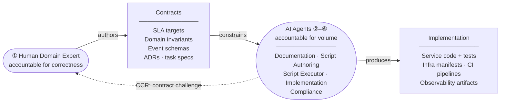

# Chakraview AI Dev Model

> **Humans are accountable for correctness. Agents are accountable for volume.**

---

## What This Framework Solves

Most AI-assisted development fails at the same place: engineers give agents vague instructions and get inconsistent, unmaintainable output. The root cause is not the agent — it is the missing contract between human intent and agent implementation.

This framework makes that contract explicit. Humans author *contracts* — precise, versioned specifications of business intent. Agents receive task specs that enumerate exactly which contracts to read and exactly what to produce. The line between what humans wrote and what agents built is structural, not informal.

---

## At a Glance

-   :material-account-hard-hat:{ .lg .middle } __6 Personas__

    ---

    Human Domain Expert, Documentation Agent, Script Authoring Agent, Script Executor, Implementation Agent, and Compliance Agent — each with explicit inputs, outputs, and constraints.

    [:octicons-arrow-right-24: Browse Personas](personas/index.md)

-   :material-file-document-check:{ .lg .middle } __The Mechanism__

    ---

    Contracts define the boundary. The agent-vs-script decision rule keeps judgment separate from transformation. Guardrails prevent drift.

    [:octicons-arrow-right-24: Understand the Mechanism](mechanism/index.md)

-   :material-source-branch:{ .lg .middle } __7-Phase Workflow__

    ---

    From bootstrap (contracts + validation script) through continuous operation (contract change response, new bounded context). Each phase has explicit persona sequencing and human review gates.

    [:octicons-arrow-right-24: See the Workflow](workflow/index.md)

-   :material-file-code:{ .lg .middle } __Ready-to-Use Templates__

    ---

    Parameterised task spec templates for all agent and script tasks. Drop them in, fill in your domain specifics, and run.

    [:octicons-arrow-right-24: Browse Templates](../templates/)

---

## The Model in One Diagram

Humans author *contracts* — the precise, versioned expression of business intent. Agents implement from those contracts. An agent that drifts from a contract produces a defect traceable to a missing or ambiguous contract, not to the agent itself. When technical reality makes a contract too costly to honour, agents surface a Contract Challenge Report — the only documented path back to amending a human-authored contract.

---

## See It In Practice

[chakraview-enterprise-modernization](https://github.com/naren-chakraview/chakraview-enterprise-modernization) used all 6 personas to modernise a Java EE monolith to cloud-native microservices. Read [how it was built](https://naren-chakraview.github.io/chakraview-enterprise-modernization/how-this-was-built/).
