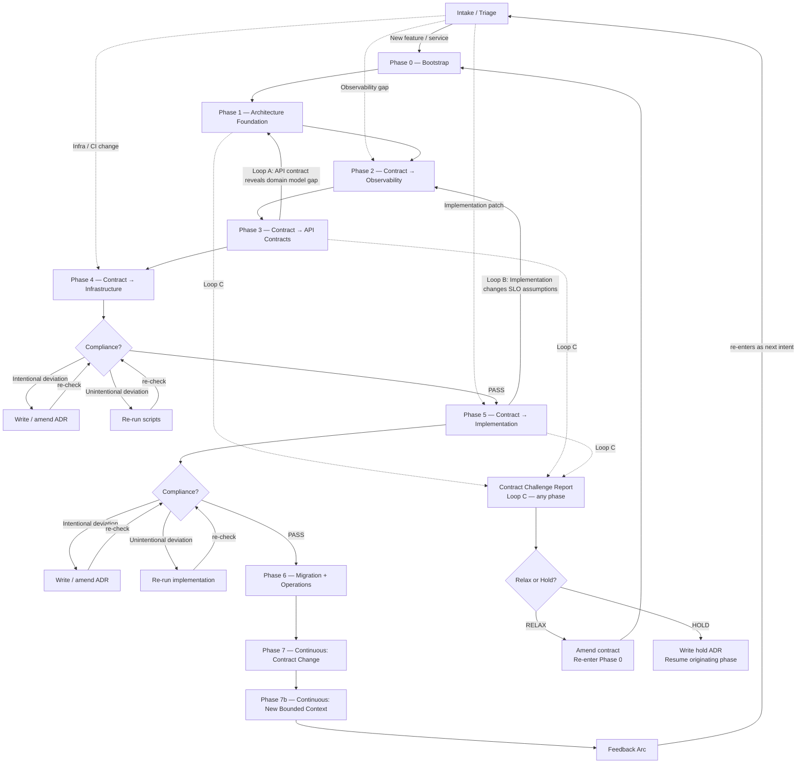

# Workflow

The workflow is a **closed cycle**. Business intent enters at **Intake/Triage**, is classified and routed to the right phase entry point, executes through the relevant phases, reaches the running system, and generates signals that re-enter as the next business intent.

Phases 0–6 must run in order — each phase's outputs are required inputs for the next. Phase 7 and 7b are the **feedback arc**: they detect change signals from the running system and produce the next Intake input, closing the loop.

Full Intake/Triage documentation: [Intake/Triage](../intake/index.md)

---

<object type="image/svg+xml" data="../assets/workflow-animation.svg"
        style="width:100%;display:block;margin-bottom:2rem;"></object>

## Detailed Flow Reference

!!! note "Loop C — HOLD path"
    When the outcome is HOLD, the agent resumes from the phase that raised the CCR (P1, P3, or P5 — whichever issued it). The diagram shows HOLD as a terminal node because the resume destination is the dynamic originating phase, not a fixed next step.

---

## Phase Descriptions

### Intake / Triage

All business intent enters here — user stories, feature briefs, incident reports, market signals. No required format.

**Round 1 — Compliance Agent + Implementation Agent** challenge the intent from their domain: ADR conflicts, bounded context boundaries, edge case gaps, state ownership, data shape completeness. The human resolves each challenge; the intake document is updated.

**Round 2 — Documentation Agent + Script Authoring Agent** re-read the updated intake document: ubiquitous language enforcement, ADR scope decisions, runbook implications, scriptability assessment, validation needs, generation targets.

**Outputs:** Intake Report (annotated decisions + open risks) · Draft Contracts · Triage Decision (phase entry point).

---

### Phase 0 — Bootstrap

**Persona 1 (Human Expert)** authors the foundational contracts: `contracts/slas/`, `contracts/domain-invariants/`, `contracts/event-schemas/`, `tooling/service-manifest.yaml`, and task specs in `ai-agents/tasks/`.

**Persona 3 (Script Authoring)** writes `validate-contracts.sh` — the contract coverage validation script that runs in every subsequent phase and in CI.

**Persona 4 (Script Executor)** runs the baseline validation pass to confirm the contract set is internally consistent before any architecture work begins.

---

### Phase 1 — Architecture Foundation

**Persona 1 (Human Expert)** authors ADR stubs, `docs/ddd/bounded-contexts.md`, and `docs/ddd/ubiquitous-language.md`.

**Persona 2 (Documentation Agent)** expands stubs into full ADRs in MADR format, and produces `docs/ddd/{service}/domain-model.md` and `docs/ddd/{service}/state-machine.md` from the invariant documents.

**Human review gate:** Are the ADRs correct? Do the domain models match the invariants? Errors here propagate through every downstream phase.

---

### Phase 2 — Contract → Observability

**Persona 3 (Script Authoring)** writes `tooling/generate-{artifact}.py` — the script that transforms SLA targets into SLO definitions and burn rate alerts.

**Persona 4 (Script Executor)** runs the script, producing `observability/slos/*.yaml` and `observability/alerts/*-burnrate.yaml`. `validate-contracts.sh` verifies the SLA↔SLO↔alert chain is complete.

**Human review gate:** Do the thresholds reflect the SLA intent? Are burn rates calibrated correctly?

---

### Phase 3 — Contract → API Contracts

**Persona 2 (Documentation Agent)** produces `api/openapi/*.yaml` (OpenAPI 3.1) and `api/asyncapi/*.yaml` (AsyncAPI 3.0) from the domain models and event schemas.

**Human review gate:** Does the API match the domain model? Are breaking-change rules clearly defined?

**Loop A** — if API contract authoring reveals a concept missing from the domain model, Phase 3 pauses and Phase 1 re-runs scoped to the gap.

---

### Phase 4 — Contract → Infrastructure

**Persona 3 (Script Authoring)** writes `tooling/generate-helm-boilerplate.sh` and `tooling/generate-ci-workflow.sh`.

**Persona 4 (Script Executor)** runs the scripts, producing Helm charts, CI workflows, and CODEOWNERS.

**Persona 6 (Compliance Agent)** audits the generated infrastructure against accepted ADRs and architectural principles. Output: `ai-agents/reviews/infra-compliance-{service}-{date}.md`.

- **PASS** → proceed to Phase 5
- **Intentional deviation** → Persona 1 writes/amends an ADR; Persona 6 runs a scoped second pass
- **Unintentional deviation** → Personas 3 + 4 re-run with the compliance report as context

---

### Phase 5 — Contract → Service Implementation

**Persona 5 (Implementation Agent)** implements the domain, application, and infrastructure layers. Reads: `contracts/`, `docs/ddd/`, `api/openapi/`, `ai-agents/context/`. `validate-contracts.sh` verifies event classes match their JSON Schemas.

**Persona 6 (Compliance Agent)** audits the implementation. Output: `ai-agents/reviews/impl-compliance-{service}-{date}.md`.

- **PASS** → proceed to Phase 6
- **Intentional deviation** → Persona 1 writes/amends an ADR; Persona 6 runs a scoped second pass
- **Unintentional deviation** → Persona 5 re-runs with the compliance report as context

**Human review gate:** Are all invariants enforced? Are OTEL metric names and histogram bucket boundaries correct?

**Loop B** — if implementation reveals the approach changes SLO assumptions, Phase 5 pauses and Phase 2 re-runs scoped to the affected SLO.

---

### Phase 6 — Migration + Operations Documentation

**Persona 2 (Documentation Agent)** produces `docs/migration/` (phase docs with risk assessment, dependency ordering, rollback procedures) and `docs/runbooks/` (one runbook per failure mode referenced in the SLA).

**Human review gate:** Are rollback gates tied to specific alerts? Do runbooks reference the correct alert names?

---

### Phase 7 — Continuous: Contract Change

Handles contract amendments after the system is running:

| Change type | Path |
|---|---|
| SLA target changed | Persona 4 re-generates alerts · Persona 6 compliance check |
| Domain invariant changed | Persona 5 re-implements · Persona 4 validates · Persona 6 checks |
| Event schema change (additive) | Persona 5 updates event class · Persona 2 updates AsyncAPI |
| Event schema change (breaking) | Persona 1 writes ADR first · then additive path |

---

### Phase 7b — Continuous: New Bounded Context

**Step 1:** Persona 1 makes the context boundary decision and authors an ADR stub. Persona 6 reviews for coupling risks, shared-DB violations, and integration pattern.

**Steps 2–7:** The new context runs the full cycle — Contracts → Architecture Foundation → Observability → API Contracts → Infrastructure → Implementation → Migration + Operations.

---

### Feedback Arc

The running system generates the next business intent. Every signal re-enters through Intake/Triage — no signal reaches Phase 0 without passing through Intake first.

| Signal | Re-enters as |
|---|---|
| SLA breach alert | "Invariant gap" → Intake Round 1 |
| Contract change detected | Direct to Phase 0 |
| New bounded context decided | Full intake dialogue |
| Compliance review failure | "ADR amendment needed" → Intake Round 1 |
| CCR resolution — contract relaxed | Amended contract → Phase 0 direct |

---

### Loop C — Contract Challenge Report (any phase)

Any agent persona (2, 3, 5, or 6) may raise a Contract Challenge Report when a contract is too costly or complex to honour. The agent halts work on the affected contract, writes a CCR to `ai-agents/reviews/ccr-{service}-{date}.md`, and routes it to the Human Domain Expert.

The Human Domain Expert routes to the product/business owner:

- **RELAX** — amend the contract, re-enter Phase 0
- **HOLD** — write an ADR explaining why the contract stands at this cost, resume from the originating phase

See: [CCR Threshold Rule](../adrs/adr-ccr-threshold.md) · Template: `templates/agent-tasks/contract-challenge.md`
